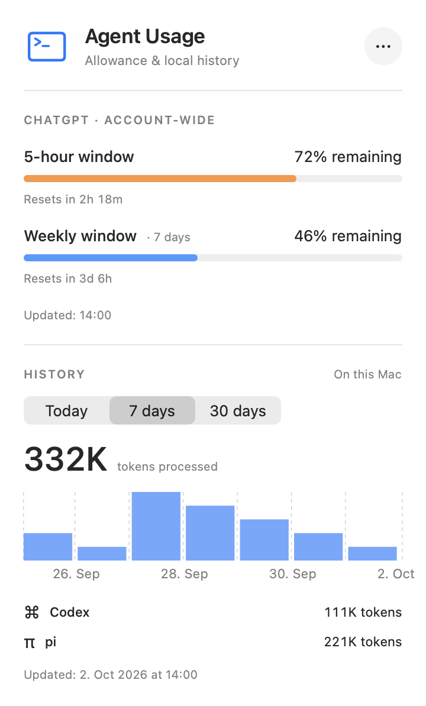

# Agent Usage

Your ChatGPT limits and local [pi](https://pi.dev) token usage, right in your macOS menu bar.



*Example dashboard with synthetic data.*

## Install / run

Requires macOS 13 or newer and Swift 6 / Apple Command Line Tools (or Xcode) to build. Local token totals require existing pi histories.

```sh
make app
```

Open `.build/Agent Usage.app`, or copy it to `/Applications` and open it there. It runs in the menu bar without a Dock icon; use its options menu to Refresh or Quit. The copied app doesn't need Swift or a terminal to run.

For ChatGPT limits, sign into OpenAI with your ChatGPT subscription using `/login` in pi, then refresh Agent Usage.

To run from source without creating an app bundle:

```sh
swift run
```

## Privacy and limitations

- **History stays local.** The app reads pi histories without uploading or modifying them. Its in-memory index keeps timestamps and token counts, not transcripts.
- **ChatGPT access uses pi's login.** Allowance requests use pi's existing OpenAI credentials. The app never modifies credentials or refreshes tokens; if access expires, use OpenAI in pi or sign in again, then refresh.
- **Limits and tokens measure different things.** ChatGPT limits are account-wide. Token totals cover only pi history on this Mac for today, the last 7 days, or the last 30 days. Other agents and API cost estimates aren't supported yet.
- **History isn't a live counter.** Reopen the panel or choose Refresh to update it. Missing or unreadable history isn't shown as zero usage; incomplete or stale totals carry a warning.
- **The ChatGPT integration is unofficial.** Its endpoint and pi's credential format may change without notice.
- **The app isn't notarized.** Bundles are signed ad hoc for local use, not Developer ID signed. Downloaded or quarantined copies may be blocked by Gatekeeper.

## Detailed technical notes

See [Technical notes](docs/technical-notes.md) for credential handling, refresh behavior, history paths and environment overrides, supported formats, indexing limits, and screenshot generation.

## Development

Tests require full Xcode; Command Line Tools alone don't provide XCTest in this environment.

```sh
make test          # Tests, then the isolated memory regression
make format        # Format Swift files in place
make format-check  # Check formatting without changing files
```

See the [testing and formatting notes](docs/technical-notes.md#development) for Xcode selection and the formatter version used by CI.

## License

[MIT](LICENSE) © 2026 Gad Kadosh.
